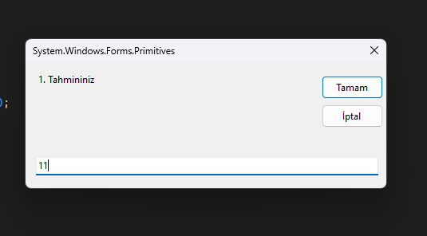
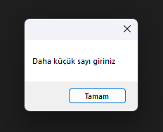
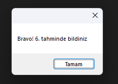

# 🎯 Sayı Tahmin Oyunu | Number Guessing Game

## 🇹🇷 Türkçe

###  Proje Hakkında
Bu proje, Görsel Programlama dersi kapsamında C# ve Windows Forms kullanılarak geliştirilmeye başlanan bir sayı tahmin oyunu arayüzüdür.

Projenin amacı, Windows Forms ile masaüstü uygulama arayüzleri oluşturmayı ve temel kullanıcı arayüzü bileşenlerini kullanmayı öğrenmektir.

###  Kullanılan Teknolojiler
- **Programlama Dili:** C#
- **Arayüz Teknolojisi:** Windows Forms
- **Geliştirme Ortamı:** Visual Studio

###  Arayüz Bileşenleri
- `Label`: Bilgi ve mesajları görüntülemek için.
- `TextBox`: Kullanıcıdan giriş almak için.
- `Button`: Kullanıcı etkileşimlerini sağlamak için.

###  Kazanımlar
- Windows Forms ile masaüstü uygulama arayüzü oluşturma
- C# ile görsel programlamaya giriş
- Formlar ve temel arayüz bileşenleriyle çalışma

###  Projeyi Çalıştırma
1. Bu depoyu bilgisayarınıza indirin veya klonlayın.
2. Projeyi Visual Studio ile açın.
3. Projeyi derleyip çalıştırın.

## 📸 Ekran Görüntüleri

---

## 🇬🇧 English

###  About the Project
This project is a number guessing game interface developed as part of a Visual Programming course using C# and Windows Forms.

The goal of the project is to learn how to create desktop application interfaces and work with basic user interface components in Windows Forms.

###  Technologies Used
- **Programming Language:** C#
- **UI Framework:** Windows Forms
- **Development Environment:** Visual Studio

###  Interface Components
- `Label`: Displays information and messages.
- `TextBox`: Accepts user input.
- `Button`: Enables user interactions.

###  Learning Outcomes
- Creating desktop application interfaces with Windows Forms
- Introduction to visual programming with C#
- Working with forms and basic UI components

###  How to Run
1. Download or clone this repository.
2. Open the project in Visual Studio.
3. Build and run the project.

## 📸 Screenshots

---

*This project was created for educational purposes as part of a Visual Programming course.*

*Bu proje, Görsel Programlama dersi kapsamında eğitim amacıyla hazırlanmıştır.*
